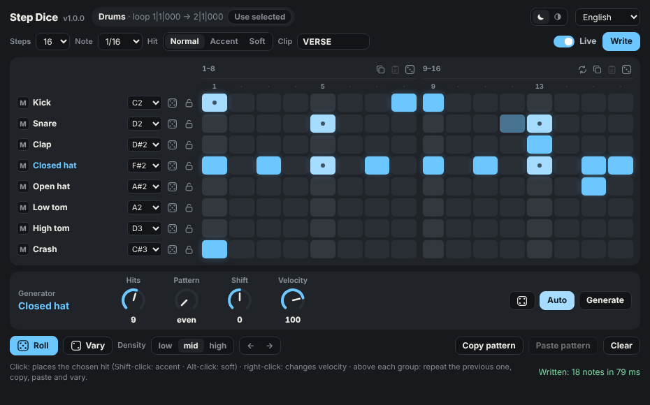
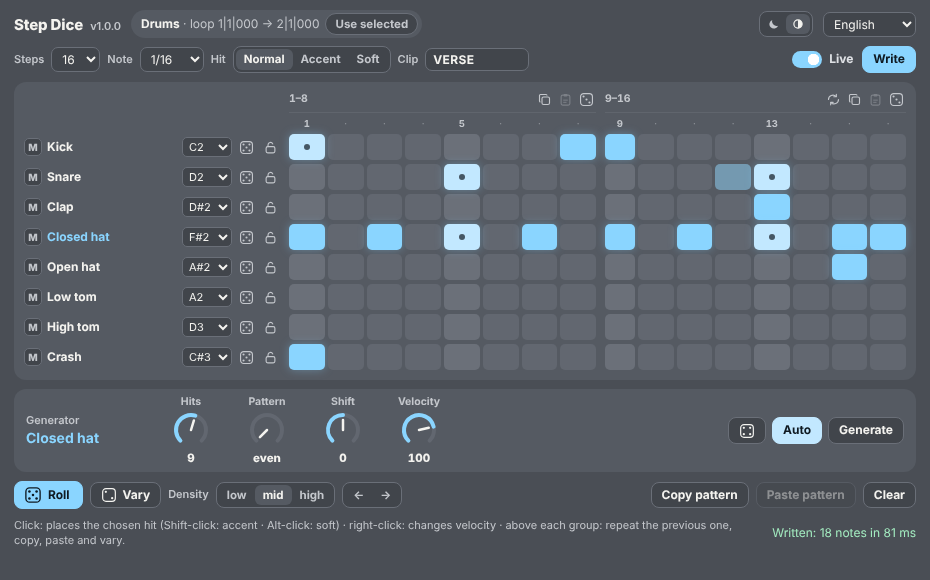

# Step Dice for LUNA

A drum step sequencer for LUNA with a die. It writes the pattern as notes into a MIDI clip over
LUNA's loop, so LUNA plays it with sample-accurate timing and you hear every change on the next
pass while the loop keeps playing. Roll the die for a new groove, vary it, shape each drum with
Hits, Pattern and Shift, accent the hits that matter, and name the clip VERSE, CHORUS or INTRO.

  
  

## Features

- **Live into LUNA:** the pattern is written into a MIDI clip over the loop (or the selection,
  or the bar at the cursor) on the instrument track you choose, and rewritten at once on every
  change. Turn *Live* off to write only when you press **Write**.
- **8 drum rows** with General MIDI notes by default (kick, snare, clap, closed and open hat, two
  toms, crash); change each row's note to match any kit.
- **8 to 32 steps** in 1/8, 1/16, 1/32 or triplets; the playing step lights up.
- **Accents:** pick Normal, Accent or Soft as the hit to place; Shift-click places an accent and
  Alt-click a soft hit; right-click changes a step's velocity.
- **The die:** roll a whole new pattern with musical sense (kick on the strong beats, snare on 2
  and 4, hats on the eighths) at low, mid or high density, or **Vary** the current one a little.
  Each row has its own die, and locked rows are never rolled. ← and → step back through your
  rolls.
- **Generator per row**, in the spirit of Ableton's Rhythm generator: **Hits** (how many),
  **Pattern** (0 spreads them evenly, 1–64 are seeded variations that favour that drum's strong
  steps), **Shift** and **Velocity**, as knobs; *Auto* regenerates as you turn them. The mouse
  wheel over a row's name adds or removes hits.
- **Blocks of 8 steps:** repeat the previous 8 steps, copy, paste or vary just that block, to
  build small variations.
- **Named clips:** INTRO, VERSE, PRE-CHORUS, CHORUS, BRIDGE, BREAK, FILL, OUTRO or your own.
- **Copy and paste whole patterns**, mute rows, clear.
- **Hear a step** as you place it while LUNA is stopped.
- **Undo** with Cmd+Z in LUNA.
- **Dark and grey themes.**
- **7 languages:** English, Español, Català, Français, Deutsch, Italiano and Português.

## How to use it

1. Make an instrument track with a drum kit, select it, and press **Use selected** in Step Dice.
2. Turn on LUNA's loop over 1 or 2 bars and press play.
3. Roll the die, click steps, turn the generator knobs: each change plays on the next pass.
4. Name the clip if you like, then move the loop and build the next section.

If the loop touches a MIDI clip without covering all of it, Step Dice asks you to extend the
clip or pick an empty gap.

## Support

If something does not work as expected, Alt-click the version number at the top of the window:
it copies a short report to paste in a message to fedetrillo@gmail.com.

## Install

Requires LUNA 3.1.2 or later. Install it from LUNA's Add On marketplace, or download
`stepdice.lunaaddon` from the latest release and double-click it. Then open a session and
choose **Add Ons > Windows > Step Dice**.

## En español

Secuenciador de batería por pasos para LUNA, con dado. Escribe el patrón como notas en un clip
MIDI sobre el bucle, así que LUNA lo toca a tempo exacto y cada cambio se oye en la siguiente
vuelta. Tira el dado para un ritmo nuevo o una variación, ajusta cada elemento con Golpes,
Patrón y Desplazar (al estilo del generador Rhythm de Ableton), pon acentos, repite o copia
bloques de 8 pasos y nombra el clip (VERSE, CHORUS, INTRO…). Modo oscuro y gris, 7 idiomas.

## Licence

Copyright (c) 2026 Fede Trillo. All rights reserved. Free to install and use in LUNA; the code
may not be copied, modified or redistributed. See [LICENSE](LICENSE). The bundled LUNA Builder
SDK is Universal Audio's, under the Apache License 2.0: see
[THIRD_PARTY_NOTICES.md](THIRD_PARTY_NOTICES.md).

Contact: fedetrillo@gmail.com
